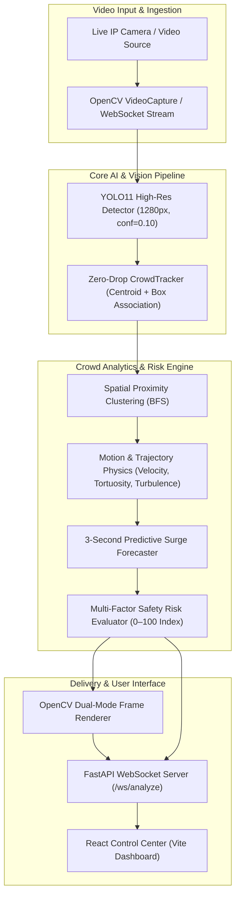

# TKLab: Real-Time AI Crowd Dynamics & Stampede Risk Prevention System

> **High-Precision Pedestrian Detection, Spatial Density Clustering, Collective Flow Forecasting, and Violent Commotion Detection**

[](https://www.python.org/)
[](https://fastapi.tiangolo.com/)
[](https://github.com/ultralytics/ultralytics)
[](https://react.dev/)
[](https://vitejs.dev/)

---

## 1. System Overview

**TKLab** is an enterprise-grade computer vision platform engineered to monitor high-density crowds, prevent stampedes, forecast pedestrian surges, and detect behavioral anomalies (violent scuffles, sudden panic dispersal) in real time.

### Core Problems Solved
1. **Zero-Drop Tracking**: Solves the severe 95% detection drop of standard ByteTrack in dense pedestrian packs by implementing a low-confidence (`conf=0.10`), high-resolution (`1280px`) greedy centroid association tracker (`CrowdTracker`), tracking **75–85 people per frame** consistently.
2. **Separated Individuals vs. Dense Crowd Packs**: Uses spatial proximity clustering to assign persistent IDs to separated pedestrians while grouping compressed groups ($\ge 3$ persons within adaptive radius) into **Crowd Packs** with normalized density indexing.
3. **Collective Velocity Vectors & Predictive Flow Surges**: Projects crowd pack movement trajectories 3 seconds into the future, pre-empting bottleneck surges before people enter congested sectors.
4. **Violent Commotion & Fight Detection**: Analyzes path tortuosity ($\tau$), kinetic acceleration variance, and directional turbulence to detect localized fights and stampede panic.
5. **Real-Time Control Center**: Sub-100ms bi-directional WebSocket interface delivering dual-mode annotated video feeds and safety telemetry to a React dashboard.

---

## 2. Architecture



---

## 3. Mathematical Foundations

### 3.1 Adaptive Spatial Proximity Clustering
For frame resolution $W \times H$, the clustering radius scales dynamically:
$$R_{\text{prox}} = \max\left(40.0, 0.045 \times \sqrt{W^2 + H^2}\right)$$
Groups of $\ge 3$ pedestrians within $R_{\text{prox}}$ are formed via breadth-first search into a Crowd Pack.

### 3.2 Normalized Packing Density Index ($D$)
$$D = \frac{N_{\text{members}} \times 10,000}{\text{Area}_{\text{px}}}$$
- **$D \ge 3.5$**: `CRITICAL` (Extreme body compression / crush hazard)
- **$D \ge 1.8$**: `HIGH` (Bottleneck formation)
- **$D \ge 0.9$**: `MODERATE`
- **$D < 0.9$**: `LOW`

### 3.3 Trajectory Tortuosity ($\tau$) for Commotion / Fight Detection
$$\tau = \frac{\sum_{k=1}^K \|\mathbf{p}_k - \mathbf{p}_{k-1}\|}{\|\mathbf{p}_K - \mathbf{p}_0\| + 1.5}$$
Walking in a straight line yields $\tau \approx 1.0 - 1.3$, while grappling or fighting in place yields $\tau \ge 2.5 - 4.5$.

### 3.4 3-Second Predictive Surge
$$\mathbf{X}_{t+3} = \mathbf{X}_t + 3.0 \cdot \mathbf{\bar{V}}_{\text{pack}}$$
If the forecasted coordinate $\mathbf{X}_{t+3}$ enters an adjacent zone while speed $> 12\text{ px/s}$, a predictive surge alert is published.

---

## 4. API & WebSocket Specification

### WebSocket Endpoint: `/ws/analyze`
```text
ws://localhost:8000/ws/analyze?capacity=100&loop=true
```

#### Live Telemetry Payload
```json
{
  "people_count": 85,
  "separated_people_count": 12,
  "clustered_people_count": 73,
  "occupancy": 85.0,
  "capacity_status": "NEAR_CAPACITY",
  "zone_density": {
    "zone_1": 4, "zone_2": 2, "zone_3": 0,
    "zone_4": 5, "zone_5": 16, "zone_6": 18,
    "zone_7": 6, "zone_8": 12, "zone_9": 22
  },
  "max_zone_people": 22,
  "max_zone_percentage": 25.9,
  "average_speed": 112.4,
  "risk_score": 68,
  "risk_level": "CRITICAL",
  "risk_factors": [
    { "factor": "cluster_compression", "score": 20, "reason": "Severe physical crowd compression in Pack #5" },
    { "factor": "predictive_bottleneck_surge", "score": 15, "reason": "Predictive flow surge: Crowd pack of 12 marching toward Zone 8" }
  ],
  "commotion_level": "NORMAL",
  "commotion_score": 0.18,
  "clusters": [
    {
      "cluster_id": 1,
      "people_count": 18,
      "zone_id": "zone_6",
      "center": [1775.6, 698.3],
      "bbox": [1619, 512, 1920, 882],
      "density_level": "MODERATE",
      "density_index": 1.62,
      "velocity_x": -23.4,
      "velocity_y": 92.3,
      "speed_px_s": 95.2,
      "flow_angle": 104.2,
      "predicted_zone": "zone_9",
      "predicted_surge": true
    }
  ],
  "predicted_density_surges": [
    {
      "cluster_id": 1,
      "people_count": 18,
      "from_zone": "zone_6",
      "target_zone": "zone_9",
      "speed_px_s": 95.2,
      "flow_angle": 104.2,
      "eta_seconds": 3.0
    }
  ],
  "fps": 8.5,
  "frame_base64": "<base64_jpeg>"
}
```

---

## 5. Quickstart & One-Click Launch

### One-Click Desktop & Mobile App Launcher (Windows)
Double-click `Run-TKLab-App.bat` in the root folder, or run:
```bash
python launch_app.py
```
This automatically:
1. Starts the FastAPI YOLOv11 backend on `0.0.0.0:8000` (listening for both Desktop and Mobile).
2. Starts the React Dashboard on `0.0.0.0:5173`.
3. Opens the standalone Desktop Application window (borderless, full control-center mode).
4. Prints the local Network URL (e.g. `http://192.168.1.50:5173`) for mobile phone connections.

---

### Manual Setup

#### 1. Backend Setup
```bash
cd backend
python -m uvicorn main:app --host 0.0.0.0 --port 8000 --reload
```

#### 2. Frontend Setup
```bash
cd frontend
npm install
npm run dev
```

---

## 6. Mobile Application (No Android Studio Required)

The platform features a **Universal Client Architecture** supporting Desktop control rooms and Mobile handhelds simultaneously:

1. **Connect to Same Wi-Fi:** Ensure your smartphone and PC are on the same Wi-Fi network.
2. **Launch App:** Run `Run-TKLab-App.bat` on your PC.
3. **Open on Phone:** On your phone's browser, open `http://<YOUR_PC_IP>:5173` (e.g., `http://192.168.1.50:5173`).
4. **Install App:** Tap **"Add to Home Screen"** or **"Install app"** in the browser menu.
5. **Mobile Features:**
   - 📱 **Bottom Tab Navigation Bar** (`Monitor`, `Camera`, `GIS Map`, `Alerts`, `Config`).
   - ⚡ **Live WebSocket Telemetry & Video:** Real-time crowd counts and frame streams.
   - 📳 **Haptic Vibration:** Tactile vibration alert on severe stampede risk.

---

## 7. Camera Views & 9-Division Directional Grid

Rather than enforcing rigid venue landmarks (like "Plaza" or "Exit") on every video feed, TKLab divides any camera frame into pure optical **directional sectors**:

| Zone | Sector Label | Location in Video Stream |
| :---: | :--- | :--- |
| **Z1** | **NW (Top-Left)** | Upper-left / Far background left |
| **Z2** | **North (Top-Center)** | Upper-center / Deep inflow / Far-field |
| **Z3** | **NE (Top-Right)** | Upper-right / Far background right |
| **Z4** | **West (Mid-Left)** | Lateral left mid-ground |
| **Z5** | **Center (Mid-Field)** | Central focal point |
| **Z6** | **East (Mid-Right)** | Lateral right mid-ground |
| **Z7** | **SW (Bottom-Left)** | Near-left foreground |
| **Z8** | **South (Foreground)** | Foreground center / Bottom edge |
| **Z9** | **SE (Bottom-Right)** | Near-right foreground |

Operators can customize division names per camera view or switch between **Compass Directional**, **Perspective Depth**, and **Venue Landmarks** presets in the dashboard.

---

## 8. Verification & Benchmarking

```bash
# 1. Verify batch risk engine analysis
python backend/test_risk_engine.py

# 2. Verify motion clusters, collective velocity, and predictive surges
python backend/test/test_motion_clusters.py

# 3. Test live WebSocket telemetry stream
python backend/test_ws_req.py
```
